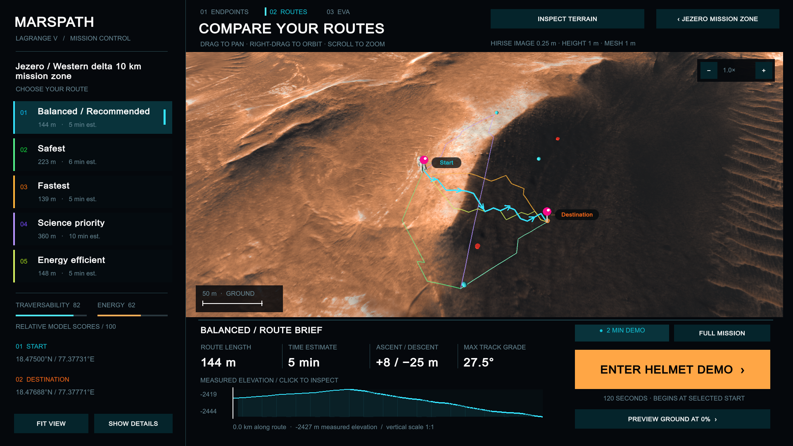

# MarsPath

### Plan. Survive. Explore.

**LAGRANGE V · NASA Space Apps Challenge prototype**

MarsPath connects Mars mission planning on a laptop with an astronaut's first-person navigation experience on Meta Quest 3. Choose a start and destination, compare terrain-aware routes, and explore the selected track through a helmet HUD and controller-driven movement.

The detailed demonstration covers a measured **10 × 10 km region of Jezero Crater** and a short **Belva Crater showcase**. The planner and helmet use the same geographic coordinates and elevation sources.

[Getting started](#getting-started) · [Algorithms](docs/ALGORITHMS.md) · [EVA equations and warnings](docs/PHYSICS_AND_HAZARDS.md) · [NASA and planetary data](docs/DATA_SOURCES.md) · [Developer handoff](HANDOFF.md) · [Downloads](https://github.com/Abdallah-Jibril/MarsPath_Hackathon/releases)



## The challenge

Future Mars explorers need to understand the terrain between a habitat and a science destination. Distance alone cannot describe the trade-offs between slope, traversability, estimated energy use, and science opportunities.

MarsPath is an independent prototype for **Interplanetary Survival Guide: Martian Map**. It combines planetary elevation products, orbital imagery, route search, and immersive navigation. Its outputs require further validation before operational use.

## Explore the application

| Experience | Capabilities |
| --- | --- |
| **Global Mars** | Rotate and zoom the globe, explore landmarks, enter coordinates, or place endpoint pins. |
| **Jezero mission zone** | Choose endpoints freely inside the supported 10 × 10 km region. |
| **Route comparison** | Inspect alternatives, route length, estimated time, sampled ascent/descent, maximum track grade, and an elevation profile. |
| **Helmet navigation** | Follow surface arrows, look around with tracked head movement, and view compact terrain warnings. |
| **Mission Control radio** | Hold to speak between Windows and Quest through authorized USB or compatible local Wi-Fi. |
| **Desktop presentation** | Demonstrate the planner and helmet view without a headset, in borderless fullscreen. |

The showcase button opens route comparison so the user chooses a route before starting. The two-minute demonstration follows the complete selected Jezero route in 120 seconds of walking. The countdown pauses with the astronaut and resumes from the same point. Longer routes outside the measured sector support a continuous preview followed by optional continuation.

## Route algorithms

| Route | Implemented search |
| --- | --- |
| **Balanced** | A* with distance and integrated modeled risk. |
| **Safest** | Lexicographic Dijkstra, prioritizing risk and then distance. |
| **Fastest** | A* minimizing three-dimensional travel distance. |
| **Science priority** | Stage-expanded A* through ordered science stops. |
| **Energy efficient** | A* minimizing estimated energy. |
| **Resource-constrained Balanced** | Multi-label A* for RCSP, with Pareto-dominance and lower-bound pruning. |

The implemented engine is **C# inside Unity**. A separate C++ service remains a proposed integration. See [algorithm definitions, constraints, and validation](docs/ALGORITHMS.md).

## Terrain and scientific scope

- The Jezero zone uses the **USGS Mars 2020 TRN HiRISE DTM**, with a native **1 m height grid** and a matching registered orthomosaic.
- Selected Belva and western-delta image windows retain **0.25 m imagery**. The wider zone uses 1 m near imagery and a separate overview.
- Elevations use **1:1 physical vertical scale**. Rendered mesh spacing changes with distance and device capability.
- Global context and regional fallbacks use **MOLA, HRSC/MOLA, HRSC, and CTX** products as available. Fine stereo coverage is geographically limited.
- QGIS preparation and independent checks retain source registration, valid-data masks, affine transforms, and elevation reference points.

**Grid spacing is not absolute measurement accuracy.** Stereo artifacts and registration limitations remain part of the source products. Small rock meshes and their placement are illustrative. Suit oxygen, energy, risk, and science scores are prototype estimates. Warm surface coloration is a display treatment of orbital imagery.

See [data sources and attribution](docs/DATA_SOURCES.md) and the [Jezero coverage audit](GIS/OfficialSurfaceSources/JezeroMissionZone10km/README.md).

### Oxygen, electrical use, and warnings

The shared engineering model separates body metabolism from suit electricity. Signed DEM grades drive gravitational work, the Weir calorimetry conversion estimates oxygen demand, and explicit electrical loads deplete a configured battery. Route scores do not feed into physiology. The parameters distinguish reference values from concept-suit assumptions; no calibrated Mars-human performance or thermal-safety claim is made.

Slope warnings use source-elevation gradients and a declared 10° caution policy. Rock warnings count visible rendered models in a forward corridor; individual rock locations remain illustrative. See [equations, units, examples, sources, and limitations](docs/PHYSICS_AND_HAZARDS.md).

## Getting started

### Run a packaged build

Download the Windows ZIP or Quest APK from the [EVA Physics v1 release](https://github.com/Abdallah-Jibril/MarsPath_Hackathon/releases/tag/eva-physics-v1-2026-11-14). Its [package manifest](docs/PHYSICS_PACKAGES.json) identifies the new shared model. The earlier migration package is retained as a historical build.

**Windows:** extract the complete ZIP and open `MarsPath.exe`. Keep its adjacent data folders and libraries together. `Alt+F4` closes the application.

**Quest 3:** enable Developer Mode, authorize USB debugging, and install `MarsPath.apk`. Open MarsPath from the headset's application library. See [the handoff](HANDOFF.md#build-and-install) for installation commands.

### Open the source

Install Git LFS before cloning. Use **Unity 6000.6.5f1** with Windows build support and Android build support, including SDK, NDK, and OpenJDK.

```powershell
git lfs install
git clone https://github.com/Abdallah-Jibril/MarsPath_Hackathon.git
Set-Location MarsPath_Hackathon
git lfs pull
```

Open `MarsPathUnity` in Unity Hub. Open `Assets/Scenes/MarsPathDemo.unity` and press **Play**. Large source assets use Git LFS. Generated Unity caches and build folders are excluded.

## Try the reference demo

1. Choose **JEZERO HACKATHON DEMO**.
2. Compare the route alternatives and select a feasible route.
3. Choose **2 MIN DEMO** or **FULL MISSION**, then enter the helmet view.
4. On Quest, hold the **right index trigger** to walk and release it to stop. Turn your head to look around.
5. For free endpoint selection, return to **JEZERO 10 × 10 KM ZONE**.

Desktop controls include left-drag to pan, right-drag to orbit, wheel to zoom, `V` for visor/chase view, and `Esc` for the mission menu. During a mission, hold keyboard `Y` to transmit voice. On Quest, hold the **left index trigger** to transmit. Both devices must be in a mission, but their chosen routes can differ.

See the [complete control table](HANDOFF.md#controls) for context-dependent Quest buttons.

## Project layout

```text
MarsPathUnity/       Unity runtime, Quest UI, scenes, assets, build methods
GIS/                QGIS projects, source provenance, native terrain references
tools/              Data preparation, verification, build and install helpers
docs/               Algorithms, scientific sources, migration and package records
Presentation/       Final presentation and supporting demonstration clips
Reports/            Team report in PDF and editable Word formats
outputs/            Selected application screenshots and review evidence
work/               Earlier engineering and source-analysis notes
```

## Technology

| Layer | Implementation |
| --- | --- |
| Application | Unity 6000.6.5f1, C# |
| XR | OpenXR 1.17.0, Quest 3 controllers and head tracking |
| Quest build | Android, IL2CPP, ARM64, Vulkan |
| Interface | Unity UI 2.6.0, desktop planning, world-space Quest panels |
| GIS preparation | QGIS and Python for DEM, slope, imagery, and source audits |
| Voice | Local encrypted audio, USB forwarding, Wi-Fi discovery |
| Large assets | Git LFS and documented source products |

## Validation and current limits

The current physics revision passed 46 independent balance/geometry assertions, exhaustive-reference routing checks, encrypted radio checks, real DEM route-facts checks, Windows application flow, and the Belva showcase. Both Windows and Quest packages were rebuilt. See [the verification record](docs/PHYSICS_VALIDATION.md).

These are software checks. Physical acceptance of the rebuilt Quest package, including comfort, tracking, microphone capture, and audibility, remains a device-test step. The locomotion and suit-load assumptions still need empirical calibration.

The radio link does **not** yet synchronize a selected desktop route into a waiting headset mission. See [handoff status](HANDOFF.md#verification-and-open-work) for remaining work.

Repository and package checks are recorded in [Migration Validation](docs/VALIDATION.md).

## Team and credits

**LAGRANGE V**

| Team member | Project responsibility |
| --- | --- |
| Abd-Al Salam Dweikat | Data resources and collection |
| Asma Nairat | Data resources and collection |
| Aram Odeh | Algorithm and data analysis research |
| Haneen Turkieh | Algorithm and data analysis research |
| Abdallah Jibril | Desktop application and Meta Quest 3 implementation |

Data and imagery are credited to their producers, including NASA mission teams, JPL-Caltech, USGS Astrogeology, HiRISE, ASU, MSSS, ESA/DLR, and the PDS Geosciences Node where applicable. See [THIRD_PARTY_NOTICES.md](THIRD_PARTY_NOTICES.md).

This private repository was initialized on **14 November 2026** by importing an existing MarsPath codebase and data package. Import commits record repository organization and packaging. See [migration provenance](docs/MIGRATION.md).
